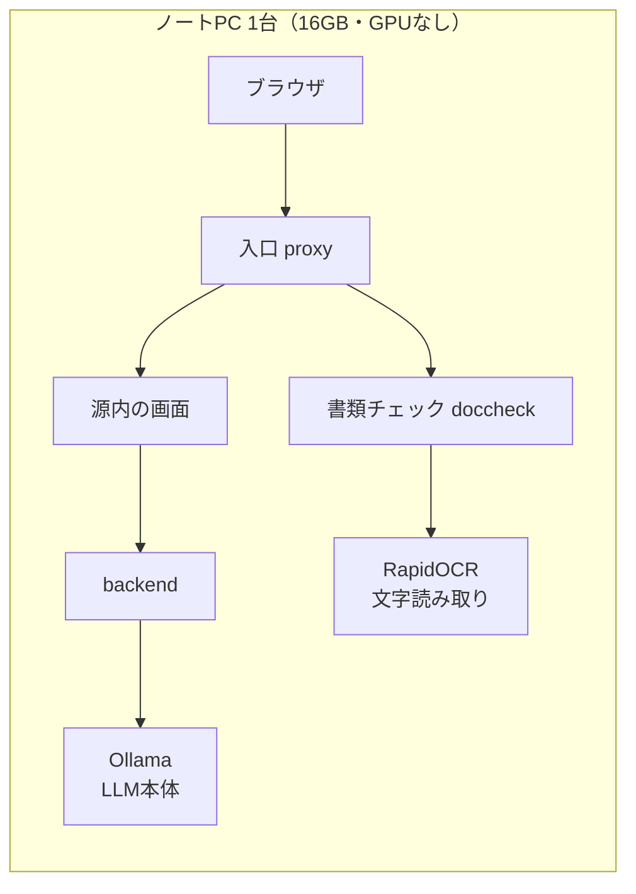

# 源内OSSの閉域移植（非公式）

## 概要（30秒で読めます）

- デジタル庁が公開したガバメントAI「源内」のOSSとローカルLLMを組み合わせ（源内OSS＋ローカルLLM）、**メモリ16GB・GPUなしのノートPC1台**の中だけで動かした記録です。
- LLM（文章を生成するAI本体）も文書の読み取りも手元のPCで完結させ、外部のAIサービスを呼ばない構成にしました。
- 既定で起動する部品19個のうち、用途に要るものだけに絞って13個で動かしています。
- 3Bと7Bの2つのモデルを同じ質問で比べ、16GB機で「何ができて、何ができないか」を実測で残しました。
- クラウドで使う源内と、この構成を並べて、処理のブロックごとに使い分ける運用を組み立てています（「開発」の節）。

記録日：2026年10月8日（「開発」の節は2026年11月10日に追記）

## 位置づけ

- **非公式**の検証です。デジタル庁および源内の開発元とは関係がありません。
- 源内の代替を作るものではありません。公開されているOSSと公開資料の範囲だけを使っています。
- 動かしたのは、源内OSSをローカル動作向けに改変したフォーク [hirokawaguchi/open-genai](https://github.com/hirokawaguchi/open-genai)（コミット 379e840・2026年10月6日）です。フォークはその後も更新が続いています。
- 源内OSSの本体は [digital-go-jp/genai-web](https://github.com/digital-go-jp/genai-web) と [digital-go-jp/genai-ai-api](https://github.com/digital-go-jp/genai-ai-api) です。

## 開発：クラウドの源内とローカルLLMを使い分ける

要件定義、設計、開発、教育支援・デバッグ、実装と進める工程のうち、開発にあたる部分の記録です。

### 手元にある2つの環境

| | クラウド側 | ローカル側 |
|---|---|---|
| 中身 | 源内AI 自治体版 Ver2.0（一般社団法人 日本DX地域創生応援団の提供。地域DXプロデューサー認定者として利用しています） | このリポジトリの構成（源内OSS＋ローカルLLM） |
| 載っているもの | アプリ52件 | 対話、ナレッジ検索、書類チェックなど、絞った部品13個 |
| 置く処理 | 外に出せる情報の処理、速さと正確さが要る処理 | 外に出せない情報を含む処理 |

2つは並べて使い分けます。ローカル側からクラウドを呼ぶ構成ではありません。

### 一つの組織が使うのは一部、という前提

クラウド側のアプリ52件は、使う相手ごとに区分されています。

| 区分 | 件数 | 主に使うと見込む相手 |
|---|---|---|
| デジタル庁 提供アプリ | 8 | どの組織でも |
| 全国自治体 専用アプリ | 13 | 自治体 |
| 地域未来交付金 申請 | 7 | 交付金を申請する自治体の担当課 |
| 行政書類の自動審査 | 8 | 自治体の福祉・税の担当課、福祉関係の団体 |
| 企業（法人会員）アプリ | 8 | 中小企業と、それを支える団体 |
| 学校教員 専用アプリ | 7 | 学校 |
| セキュリティ診断・強化 | 1 | どの組織でも |

「主に使うと見込む相手」は作成者の見立てです。一つの組織が日々使うのは、このうちの一部です。

そこで、いったん全部を下げておき、よく使うものだけを上げる、という使い方にします。

- ローカル側は、既定の19個から7個を止め、書類チェックを足した13個で動かしました（実測）。
- フォークの現行版（コミット 6d5ed81・2026年11月9日）には、追加の部品を選んで起動する仕組み（profiles）、一覧に出すアプリを絞る設定、よく使うアプリを上に固定する仕組みがあります。ソースで有無を確かめた範囲で、この検証（379e840）では動作を確かめていません。

### ブロックごとに置き場所を決める

業務の処理をブロックに分け、ブロックごとに置き場所を決めます。こうすると、閉域（外につながない環境）が特に要るのはどのブロックかが分かります。

| ブロックの中身 | 置き場所 |
|---|---|
| 個人情報など、外に出せない情報を含む処理 | ローカル側（PCの中） |
| 外に出せない情報を含まない処理 | クラウド側 |

全体を閉域にする必要はありません。必要なブロックだけをPCの中に置きます。

ブロックごとの判定には [生成AI配置判定エイド（ブロック別）](https://github.com/takashi-101/fde-checklist/blob/main/cloud-or-local-blocks.html) を使います。

### 閉域が特に要ると見ている処理

福祉分野の書類（ケアプラン、個別支援計画、生活保護の申請書類など）は、高齢化で件数が増える一方、個人情報の扱いが最も厳重な書類です。クラウド側では「行政書類の自動審査」の区分にあたり、ローカル側で同じ種類の書類を受ける入口が書類チェック（doccheck）です。

### 使う相手は自治体に限らない

「行政書類の自動審査」が扱う書類には、審査する側と、作って出す側がいます。たとえばケアプランの点検は、令和6年度（2024年度）に1,573保険者のうち1,552（98.7％）が実施しています（[厚生労働省資料](https://www.mhlw.go.jp/content/12300000/001750955.pdf)）。ケアプランを作る居宅介護支援事業所は、その点検を受ける側にいます。

同じ書類を、出す前に自分で確かめる使い方を考えると、相手は次のように広がります。

| 相手 | 使いどころ | 置き場所 |
|---|---|---|
| 自治体の福祉・税の担当課 | 受け取った書類の確認 | 個人情報を含むブロックはローカル側 |
| 居宅介護支援事業所、障害福祉の事業所、社会福祉法人 | 提出前・点検前の記載漏れの自己点検 | ローカル側 |
| 社会福祉協議会などの外郭団体 | 自治体から受けている事務の書類確認 | 個人情報を含むブロックはローカル側 |
| 商工会など、中小企業を支える団体 | 補助金や事業計画の相談対応 | 公開情報が中心のためクラウド側 |

出す側の団体が求める処理は「記載漏れの確認」が中心で、16GB機のローカル側に置ける処理の範囲に収まります。使っていないPC1台から始められる点も、この構成の持ち味です。

この表は作成者の見立てで、これらの団体での試行はこれからです。

### 現在地

| 段階 | 内容 |
|---|---|
| 済んだこと | 13個での起動、手元のLLMとの対話、3Bと7Bの比較 |
| これから | 書類チェックの様式登録と1件投入、7Bでのナレッジ検索、一つの業務をクラウド側とローカル側に分けて流す試行 |

16GB機の正確さは下の実測のとおりです。そのためローカル側に置くのは、人が原本と突き合わせて確かめられる処理（要約、分類、言い換え、記載漏れの確認）に絞ります。

## 構成

外部のAIサービスは呼びません。

| 項目 | フォークの既定 | この検証 |
|---|---|---|
| 機材 | 指定なし | CF-FV（メモリ16GB・GPUなし・Windows） |
| コンテナ（部品を箱ごと動かす仕組み） | 19個が起動 | 7個を止めて12個、書類チェックを足して13個 |
| 対話用モデル | qwen2.5:7b | qwen2.5:3b と qwen2.5:7b を比較 |
| 文書検索用モデル | gpt-oss:20b | qwen2.5:3b |
| 埋め込みモデル（文書検索の下ごしらえ） | mxbai-embed-large | 既定のまま |
| 音声の文字起こし | medium | small |
| 書類チェックの文字読み取り | 自信が低いときクラウドのモデルを呼ぶ | 手元で動く RapidOCR に固定 |
| LLMの置き場所 | Ollama | Ollama（コンテナの外、Windows側） |

## 実測

| 項目 | 値 |
|---|---|
| 動いているコンテナ | 13個 |
| コンテナ側のメモリ使用量 | 約3.7GB【要確認】 |
| 起動にかかる時間 | 約6分【要確認】 |
| 3Bと7Bの所要時間の差 | 7Bは3Bの1.3〜2.6倍（質問5問） |

同じ質問5問（25点満点）での比較

| モデル | 得点 | 致命的な誤りがあった質問 |
|---|---|---|
| qwen2.5:3b | 16／25 | 4問 |
| qwen2.5:7b | 18／25 | 2問 |

## できたこと

- 源内の画面にログインし、手元のLLMと日本語で対話する
- ナレッジ検索（登録した資料をもとに答える機能）が一覧に出る
- 書類チェック（doccheck）の画面を開く
- 一部の部品の外向きの通信口を閉じる
- データの退避・復元のスクリプトを用意する

## できなかったこと・未実施（記録日時点）

- 3Bは5問中4問で致命的な誤りがあり、内容の正しさが要る用途には使えない
- 7Bでも誤りは残り、3Bより遅い
- 書類チェックはPDFを読み込めない（コミット 379e840 時点。画像のみ）
- 書類チェックの様式登録と1件投入は未実施
- 7Bでのナレッジ検索は未検証

## このリポジトリに置いていないもの

起動の手順、設定ファイル、退避・復元のスクリプトは公開していません。

## 根拠（学習）

| 求められる力 | 機能 | 裏付けになる学習（発行元・名称・発行日） | 照会先（Credly） |
|---|---|---|---|
| クラウドと閉域の基盤 | 起動する部品（コンテナ）を19個から13個に絞った構成 | Amazon Web Services Training and Certification「AWS Knowledge: Amazon ECS - Training Badge」2025年11月12日 | https://www.credly.com/badges/b73f91ba-c58c-42ce-a05a-c8909e4a4354 |
| 生成AI・LLMの実装（RAG・エージェント・MCP） | 文書検索（埋め込みモデル） | Coursera（認定：IBM）「Vector Databases for RAG: An Introduction」2026年11月1日 | https://www.credly.com/badges/b84b95a1-f143-467e-af35-7221f0c9ab2b |
| 生成AI・LLMの実装（RAG・エージェント・MCP） | 3Bと7Bのモデルの比較 | Coursera（認定：IBM）「Generative AI and LLMs: Architecture and Data Preparation」2026年11月1日 | https://www.credly.com/badges/d18319e6-bcc1-480e-ac79-09744b9d41aa |

「求められる力」の分け方は、[プロフィール](https://github.com/takashi-101) の「FDE・AXで求められる力と、その根拠」と同じです。

## ライセンス

- hirokawaguchi/open-genai：MIT License（Copyright (c) 2026 Open GENAI Project contributors）
- digital-go-jp/genai-web：MIT License（フォーク内の `genai-web/LICENSE` に保持）
